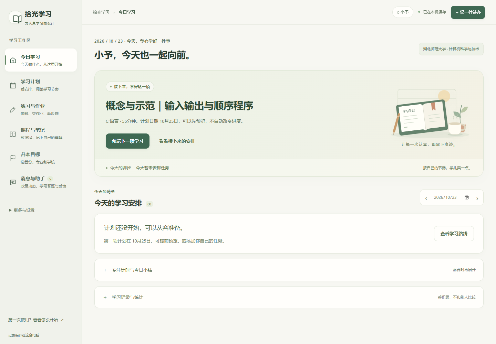
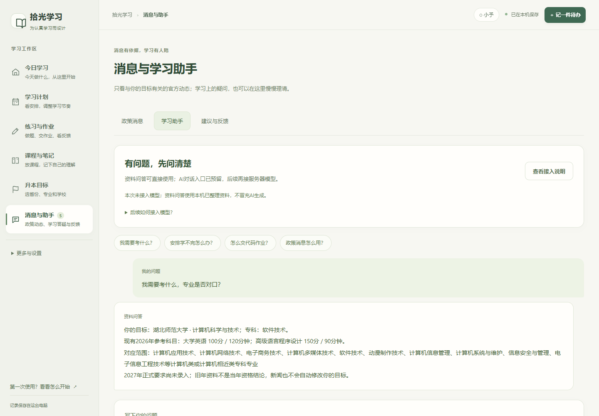

# StudyForge

**A calmer, local-first study desk: choose an evidence-backed goal, build a realistic plan, and learn through practice and revision.**

[简体中文](README.zh-CN.md) · [Quick start](docs/QUICKSTART.md) · [Content coverage](docs/CONTENT_SOURCES.md) · [Contributing](CONTRIBUTING.md) · [Roadmap](docs/ROADMAP.md)

> **Early release candidate: v0.1.0-alpha.1.** The student interface and admissions materials currently use Simplified Chinese. Repository documentation is English-first for international contributors.
>
> This is a personal-computer application, not a production cloud platform or an official admissions authority. Development is AI-assisted; engineering tests do not replace teaching or source review.

## Why this exists

Students preparing for China's ordinary college-to-undergraduate transfer examinations (*zhuanshengben*) must navigate eligibility rules, school requirements, videos, assignments, and revision. These are often scattered across unrelated tools.

StudyForge connects those steps without treating a watched video, a checked box, or a repeated correct answer as proof of mastery. It started with a software-technology student in Hubei and is being generalized one verified route at a time.

## What works today

| Area | Implemented | Still incomplete |
| --- | --- | --- |
| Admission goals | Source major → target program → school; explicit rules, exclusions, evidence and year labels | Remaining Hubei gaps; other provinces and candidate categories |
| Study plans | Adjustable workload, prerequisites, previews, protected progress and reversible changes | Learning adapters for more programs |
| Practice and revision | Original exercises, drafts, submissions, error notes, delayed review and mock sessions | Teacher-reviewed marking and broader subjects |
| Courses and notes | User-provided course links, chapter progress and task-linked notes | Video hosting and cross-device synchronization |
| News and help | Opt-in official-source discovery, route filters, reference Q&A, feedback and owner replies | Fully reviewed feeds and a connected conversational model |
| Local accounts | Passwords, recovery codes, sessions, separate student databases, exports and backups | Internet-facing identity and cloud tenancy |

The conversational AI entry is a **disabled placeholder**. Reference Q&A works without a model. Existing assignment-review integrations require explicit configuration and a manual request; startup never downloads a model.

## Coverage, stated honestly

The bundled catalog is a **Hubei 2026 reference**, not verified eligibility for 2027:

- 48 schools, 709 school/program offerings, and an 811-entry source-major dictionary.
- 338 structured eligibility rules; 433 offerings with named professional-exam subjects.
- 275 offerings with both evidence categories complete; **434 retain explicit gaps**.
- **One dedicated learning pack:** Computer Science and Technology at Hubei Normal University.
- 212 original training questions across 152 families; **not official past papers**.
- A 31-region integration checklist does not mean 31 provinces have working catalogs or learning packs.

See [provenance and expansion requirements](docs/CONTENT_SOURCES.md). Similar program names alone never establish eligibility. Historical dates and rules are not promoted to current-year facts.

## The study desk

Screenshots use a synthetic learner in an isolated workspace. The current student interface is Chinese.





## Run locally

Use Python **3.11 or 3.12**. The core web application uses only the standard library.

```sh
git clone https://github.com/Ayi-6888c/StudyForge.git
cd StudyForge
python app/app.py
```

The app opens a loopback-only, automatically selected port. A fresh installation has no previous student's account, goal, work, or progress. Set up your own account first.

For a fixed port without opening a browser:

```sh
python app/app.py --no-browser --port 8765
```

Open `http://127.0.0.1:8765/`. If occupied, change the port or omit `--port`.

### Choose your data location

Data defaults to ignored `app/data/`. Override it before startup:

```powershell
$env:STUDYFORGE_DATA_DIR = 'D:\StudyForge-data'
python app/app.py
```

```sh
STUDYFORGE_DATA_DIR="$HOME/.local/share/studyforge" python app/app.py
```

See [privacy](docs/PRIVACY.md) and [migration](docs/MIGRATION.md). Never publish the data directory.

### C execution is opt-in

Public-source review defaults to static checks: **submitted programs are not compiled or run**. To run trusted code on your own computer, configure a compiler and explicitly enable it:

```powershell
$env:STUDYFORGE_ENABLE_CODE_EXECUTION = '1'
python app/app.py
```

This is **not a sandbox**: execution uses your OS user's privileges. Do not expose the local service publicly or accept untrusted programs. A hosted judge needs separate isolation.

## Tests and packaging

```sh
python scripts/run_checks.py
python scripts/release_check.py
python scripts/build_source_archive.py
```

Core checks use temporary synthetic workspaces: no real AI calls, external news requests, or Windows notifications. Coverage includes accounts, admission matching, plan protection/rollback, practice, revision, notes, feedback and release boundaries. Catalog tests check all **574,999 source-major/offering pairs**.

See [development](docs/DEVELOPMENT.md) for optional browser tests and Windows builds. Source archives contain no private databases, backups, compiler, model weights, or bundled runtime.

[GitHub Actions](https://github.com/Ayi-6888c/StudyForge/actions) defines Ubuntu/Windows checks on Python 3.11/3.12. Inspect actual hosted results; local tests do not imply a workflow has passed.

## Contribute

Useful contributions include reproducible learning problems, source-backed corrections with exact years/clauses, teaching review, accessibility, tests, and independently verified provincial adapters. Read [CONTRIBUTING.md](CONTRIBUTING.md), use the issue templates, and report sensitive problems as described in [SECURITY.md](SECURITY.md).

We do not invent users, stars, contributors, learning outcomes, expert endorsements, or grant acceptance. Support applications should describe actual maintenance and use.

## License

Original code and project documentation use [Apache-2.0](LICENSE). See [NOTICE](NOTICE), [licensing boundaries](docs/LICENSING.md) and [third-party notices](THIRD_PARTY_NOTICES.md). External policies, textbooks, publications and dependencies retain their own rights.

StudyForge does not promise admission, predict official dates/cutoffs, or turn historical reference data into current eligibility. There are currently no payments, ads, or automatic behavioral uploads.
